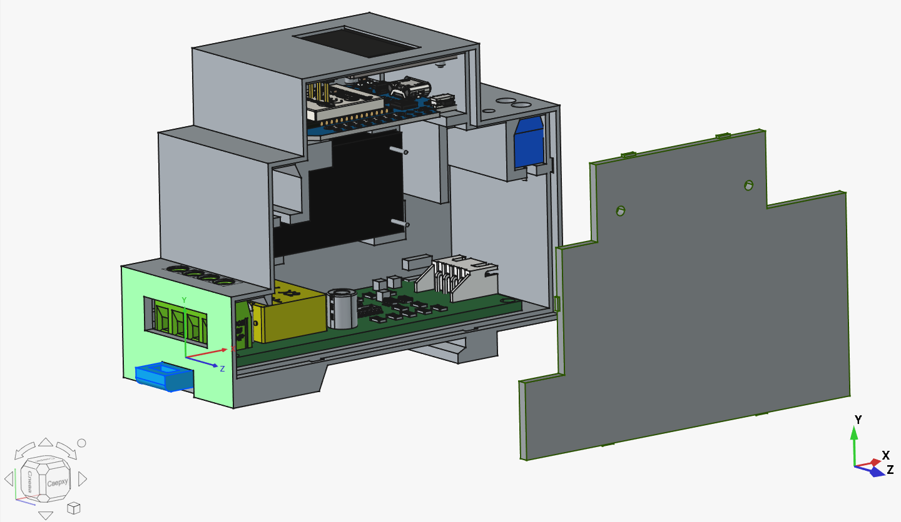
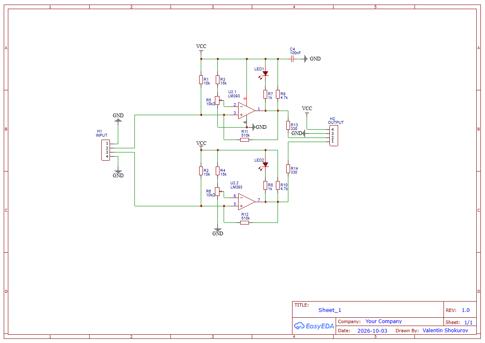
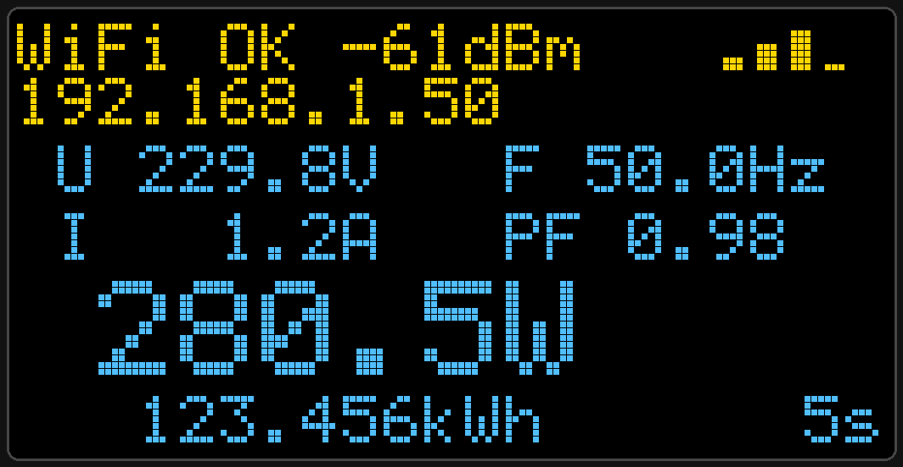
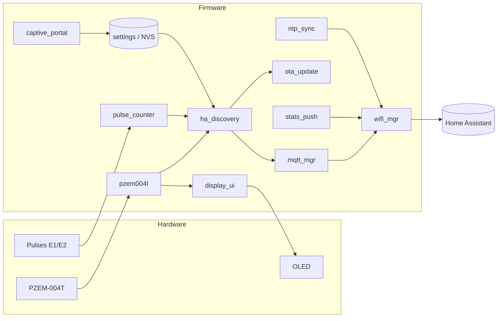

<div align="center">

# ⚡ eMeter32

**ESP32 firmware for a smart electricity meter with Home Assistant integration**

English | [Русский](README.ru.md)

[](https://docs.espressif.com/projects/esp-idf/)
[](https://platformio.org/)
[](https://www.home-assistant.io/integrations/mqtt/)
[](#)
[](LICENSE)
[](#)

</div>

---

## 📖 About

**eMeter32** measures the mains supply, counts energy from the pulse outputs of electricity meters and sends the data to Home Assistant over MQTT. It runs on an ESP32 and is written in plain ESP-IDF, with no third-party libraries.

What it does:

- measures voltage, current, power, frequency, power factor and energy with a **PZEM-004T** module;
- counts pulses from two meters (channels **E1** and **E2**) using the ESP32 hardware **PCNT** counter, without losing pulses across reboots or connection drops;
- shows its status on an OLED display;
- publishes data to MQTT and registers itself in Home Assistant (**MQTT Discovery**);
- is configured through a web page (**captive portal**), with no need to reflash;
- updates over Wi-Fi (**OTA**) through a web page served by the device.

> [!WARNING]
> This project works with **230 V** mains voltage. The PZEM-004T and the meters must be connected by someone who knows electrical safety rules. The author is not responsible for the consequences of incorrect wiring.

## ✨ Features

| Area | What is implemented |
|---|---|
| **Measurements** | Voltage, current, active power, frequency, power factor, accumulated energy (PZEM-004T over Modbus-RTU) |
| **Energy metering** | Two independent pulse channels, hardware PCNT, glitch filter, configurable meter constant (pulses per kWh) |
| **Counting reliability** | The value is stored in retained MQTT attributes and restored after a reboot; a late-arriving value does not corrupt the count |
| **Home Assistant** | MQTT Discovery: sensors, input fields (`number`), a firmware update button, availability status (LWT) |
| **Configuration** | Captive portal: Wi-Fi (with network scan), MQTT, NTP, time zone, initial readings, meter constant |
| **Display** | SSD1306 OLED 128×64: Wi-Fi status, signal level, IP address, mains readings |
| **Time** | SNTP, time zone from settings, resync once a day |
| **Statistics** | Periodic JSON push over HTTP(S) POST to your server (optional) |
| **OTA** | Update from a browser, one-time PIN, image validation, rollback to the previous version on failure |
| **Settings storage** | NVS with structure version check and checksum |

## 🧱 Hardware

### Components

| Component | Purpose |
|---|---|
| ESP32 (**WEMOS D1 mini ESP32** board, 4 MB flash) | Main controller |
| **PZEM-004T** (v3.0, UART/Modbus-RTU) | Mains measurements |
| Two pulse input channels based on **LM393** | Interface to the meters' pulse outputs |
| **SSD1306** OLED 128×64, I²C | Status display (two-colour module: yellow and blue zones) |
| Push button | Opens the configuration portal |

### Pinout

All pin assignments are in one file: [`board_config.h`](components/board_config/include/board_config.h).

| Signal | GPIO | Note |
|---|---|---|
| OLED SDA | 21 | I²C, address `0x3C` |
| OLED SCL | 22 | |
| PZEM TX (from the board) | 17 | UART1, 9600 8N1 |
| PZEM RX (to the board) | 16 | Needs a voltage divider or level shifter |
| Pulses E1 | 32 | Internal pull-up enabled |
| Pulses E2 | 33 | Internal pull-up enabled |
| Portal button | 4 | Between the pin and GND, hold for 3 s |

> [!NOTE]
> Check the pins against the markings on your board. If you change the wiring, edit `board_config.h`.

### Assembly, enclosure and boards



**Comparator board schematic** (click to open the PDF):

[](hardware/comparator-board/schematic/Schematic_Comparator_2026-10-16.pdf)

| Item | Location |
|---|---|
| Enclosure (STL models, print and assembly notes) | [`hardware/enclosure`](hardware/enclosure) ([RU](hardware/enclosure/README.ru.md)) |
| Comparator board description | [`hardware/comparator-board`](hardware/comparator-board) ([RU](hardware/comparator-board/README.ru.md)) |
| Schematic (PDF) | [`hardware/comparator-board/schematic/Schematic_Comparator_2026-10-16.pdf`](hardware/comparator-board/schematic/Schematic_Comparator_2026-10-16.pdf) |
| Gerber files for PCB manufacturing | [`hardware/comparator-board/pcb/Gerber_Comparator_PCB_Comparator_2026-10-04.zip`](hardware/comparator-board/pcb/Gerber_Comparator_PCB_Comparator_2026-10-04.zip) |

## 🖥 Display

The SSD1306 screen refreshes once a second. The top 16 pixel rows (yellow zone) show the Wi-Fi status and the IP address. The rest of the screen (blue zone) shows the mains readings.



*Layout preview with sample values (the image is a mock-up, not a photo).*

| Line | Content | Format |
|---|---|---|
| 1 | `U` voltage, `F` frequency | `%.1fV`, `%.1fHz` |
| 2 | `I` current, `PF` power factor | `%.1fA`, `%.2f` |
| 3 | Active power (double-size font) | `%.1fW` |
| 4 | Energy; at the right edge, the age of the last PZEM reading (`5s`, `2m`, `1h`) | `%.3fkWh` |

If the PZEM stops answering, `ERR` appears before the data age. Before the first answer the screen shows `PZEM: waiting...`, and `PZEM: no answer` if there are errors and no data.

**Decimal point alignment.** The numbers are drawn by `text_at_dot()` in [`display_ui.c`](components/display_ui/display_ui.c). It places the `.` character at a fixed pixel column, so the point does not move when the number of digits changes.

| Reading | Decimal point position (x, px) |
|---|---|
| Voltage, current, energy | 36 |
| Frequency, power factor | 96 |
| Power (double size) | 48 |

Digits to the left of the point: voltage and current up to 3, energy up to 5, power up to 4. For power of 10 kW and above the line is pressed to the left edge and the point shifts to the right.

## 🏗 Architecture

The project is built from independent ESP-IDF components. Each one lives in `components/` and is registered through its own `CMakeLists.txt`.



### Components

| Component | Description |
|---|---|
| `board_config` | Pin assignments and input parameters |
| `settings` | Settings in NVS: format version, checksum, defaults, validation |
| `wifi_mgr` | Wi-Fi connection with exponential back-off, falls back to setup mode when there is no connection |
| `captive_portal` | Access point, DNS hijack and the settings web page |
| `mqtt_mgr` | Wrapper over `esp-mqtt`: topic hierarchy, LWT, subscriptions |
| `ha_discovery` | Publishes entities for Home Assistant, states, and handles commands |
| `pzem004t` | PZEM-004T driver (Modbus-RTU), scheduled polling |
| `pulse_counter` | PCNT pulse counter with value restore and correction |
| `oled`, `display_ui` | SSD1306 driver with a built-in font, and the status screen |
| `ntp_sync` | SNTP, time zone |
| `stats_push` | Statistics push over HTTP(S) |
| `user_button` | Long-press handling |
| `ota_update` | Over-the-air firmware update |

## 🛠 Tools and libraries

**Tools**

- [PlatformIO](https://platformio.org/) (`espressif32` platform, `wemos_d1_mini32` board)
- [ESP-IDF](https://docs.espressif.com/projects/esp-idf/) 5.x (`espidf` framework)
- CMake and a custom partition table, `partitions.csv`

**Libraries**

There are no third-party libraries. Only standard ESP-IDF components are used:

| ESP-IDF component | Used for |
|---|---|
| `esp_wifi`, `esp_netif`, `esp_event`, `lwip` | Wi-Fi and the network stack |
| `mqtt` (`esp-mqtt`) | MQTT client |
| `esp_http_server` | Portal web server and the OTA page |
| `esp_http_client`, `esp-tls` (certificate bundle) | Statistics push over HTTP(S) |
| `nvs_flash` | Settings storage |
| `driver` (`gpio`, `uart`, `i2c`, `pcnt`) | Peripherals |
| `app_update`, `esp_app_format` | OTA, image validation, rollback |
| `mbedtls` | Base64 for the OTA page authentication |
| `esp_timer`, FreeRTOS | Timers and tasks |

The display driver and the font were written from scratch and live in the `oled` component.

## 📁 Repository structure

```text
.
├── .github/                 # issue and pull request templates
├── components/              # firmware components (ESP-IDF)
│   ├── board_config/
│   ├── captive_portal/
│   ├── display_ui/
│   ├── ha_discovery/
│   ├── mqtt_mgr/
│   ├── ntp_sync/
│   ├── oled/
│   ├── ota_update/
│   ├── pulse_counter/
│   ├── pzem004t/
│   ├── settings/
│   ├── stats_push/
│   ├── user_button/
│   └── wifi_mgr/
├── docs/images/             # photos and pictures for the documentation
├── hardware/
│   ├── comparator-board/    # schematic and PCB (Gerber)
│   └── enclosure/           # STL models of the enclosure
├── src/                     # main.c
├── CMakeLists.txt
├── partitions.csv
├── platformio.ini
└── sdkconfig.defaults
```

## 🚀 Getting started

### Requirements

- [Visual Studio Code](https://code.visualstudio.com/) with the [PlatformIO IDE](https://platformio.org/install/ide?install=vscode) extension, or [PlatformIO Core](https://docs.platformio.org/en/latest/core/installation/)
- An ESP32 board with 4 MB of flash and a USB cable

### Build and flash

```bash
git clone https://github.com/vals55/eMeter32.git
cd eMeter32

# build
pio run

# flash over USB
pio run -t upload

# serial monitor
pio device monitor
```

`platformio.ini` defines two environments: `debug` (the default) and `release`. Pick one with the `-e` flag:

```bash
pio run -e release -t upload
```

> [!IMPORTANT]
> Flash the first build **over a cable**: this writes the bootloader and the partition table. After that you can update the firmware over the air.
>
> If you are upgrading from a version without OTA, a full flash erase is not needed: the settings partition (`nvs`) stays in the same place.

### First-time setup

1. Power the device on. If Wi-Fi is not configured yet, it starts an open access point named like `eMeter32-XXXX`. The same name is shown on the display.
2. Connect to it from a phone or computer. The settings page opens automatically, or go to `http://192.168.4.1`.
3. Choose your Wi-Fi network (you can pick it from the list), enter the MQTT broker address, user name and password, and, if needed, the time zone and the initial meter readings.
4. Save. The device connects to the network and shows up in Home Assistant.

To open the settings portal again, **hold the button for 3 seconds**.

## 🏠 Home Assistant integration

The device uses [MQTT Discovery](https://www.home-assistant.io/integrations/mqtt/#mqtt-discovery) and appears in Home Assistant by itself, provided the MQTT integration is enabled and the discovery prefix matches (`homeassistant` by default).

### Entities

| Type | Name | Purpose |
|---|---|---|
| sensor | Voltage, Current, Power, Frequency, Power factor | PZEM-004T measurements |
| sensor | Energy | PZEM energy including the offset |
| sensor | Energy E1, Energy E2 | Energy from pulses (the channel and the pulse count are in the attributes) |
| sensor | RSSI | Wi-Fi signal level (IP, MAC and chip ID in the attributes) |
| sensor | Last seen | Time of the last update |
| number | Set energy E1 / E2 | Correct the channel readings |
| number | PZEM energy offset | PZEM energy offset |
| number | Meter constant | Pulses per kWh |
| number | MQTT send period | Publish period |
| number | Stat send period | Statistics push period |
| button | Firmware update | Starts the firmware update server |
| binary_sensor | Firmware update server | State of the update server |

### MQTT topics

```text
<prefix>/<chip id>/<id>/state        # state
<prefix>/<chip id>/<id>/set          # command
<prefix>/<chip id>/<id>/attributes   # attributes
<prefix>/<chip id>/status            # online / offline (LWT)
```

The default prefix is `eMeter32`. The chip ID is six hexadecimal characters (the last three bytes of the MAC address).

## 🔄 Over-the-air update (OTA)

The device is updated from a browser. The update server is **not running all the time**: it starts on command and shuts itself down after 10 minutes.

1. In Home Assistant, press the **Firmware update** button.
2. Open the attributes of the **Firmware update server** sensor: they contain the address `http://<IP>/update`, the user name `ota` and a one-time six-digit **PIN**. The PIN is also printed in the device log.
3. Open the page, enter the user name and the PIN, choose the `firmware.bin` file (folder `.pio/build/<environment>/`) and press "Upload".
4. The device validates the image, writes it to the free slot and reboots.

**Security and reliability**

- The PIN is generated anew every time the server starts and is sent over MQTT without the retain flag.
- After five wrong attempts the server shuts down.
- Only an application image from the same project is accepted, and the file is checked before and after writing.
- Flash is split into two slots (`ota_0` and `ota_1`) plus an `otadata` partition. If the new version does not reach a working state (before connecting to Wi-Fi), the bootloader returns to the previous one.

The 4 MB flash map is described in [`partitions.csv`](partitions.csv).

## 📡 Statistics push

If an address is set in the settings, the device periodically sends a `POST` request with JSON:

```json
{
  "device": "eMeter32-ABCD",
  "fw": "0.2",
  "ts": 1760000000,
  "uptime_s": 12345,
  "rssi": -61,
  "pzem": {
    "valid": true,
    "voltage": 229.8,
    "current": 1.234,
    "power": 280.5,
    "energy_kwh": 123.45,
    "frequency": 50.0,
    "pf": 0.98,
    "errors": 0
  },
  "e1_kwh": 456.78,
  "e2_kwh": 90.12
}
```

Both `http://` and `https://` addresses are supported. If the address field is empty, the push is disabled.

## 🗺 Roadmap

- [ ] Test the prototype on real hardware
- [x] Schematics and photos of the device
- [x] 3D-printed enclosure

## 🤝 Contributing

Suggestions and bug reports are welcome: open an [issue](../../issues) or send a [pull request](../../pulls). See [CONTRIBUTING.md](CONTRIBUTING.md). When you change the settings structure, increase `SETTINGS_VERSION` in `settings.h`.

## 📄 License

This project is licensed under the **MIT** license. See the [`LICENSE`](LICENSE) file for details.

© 2026 vals. Vals home Lab.
