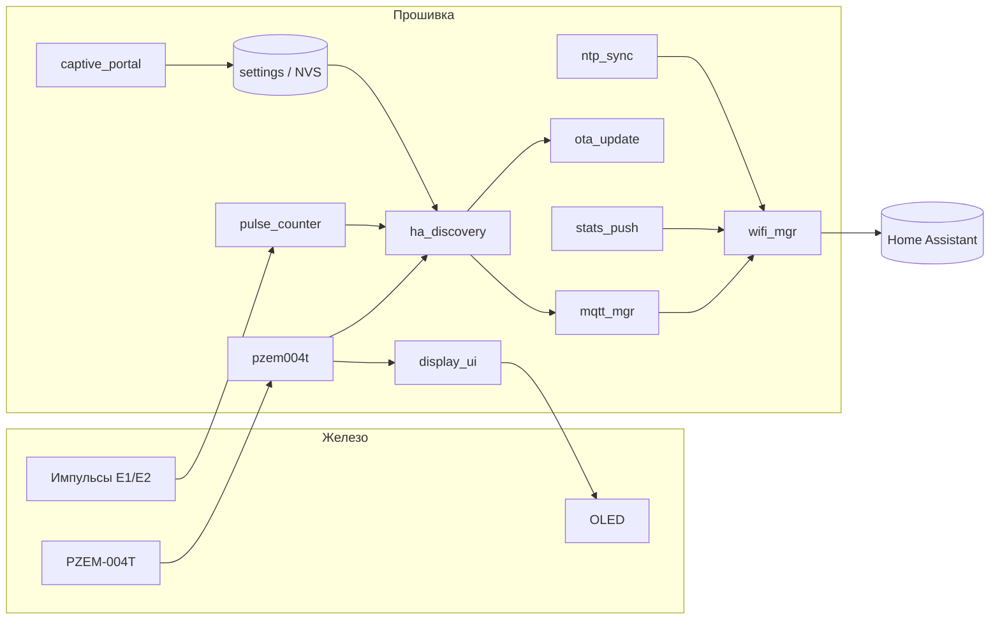

<div align="center">

# ⚡ eMeter32

**Прошивка для умного счётчика электроэнергии на ESP32 с интеграцией в Home Assistant**

[English](README.md) | Русский

[](https://docs.espressif.com/projects/esp-idf/)
[](https://platformio.org/)
[](https://www.home-assistant.io/integrations/mqtt/)
[](#)
[](LICENSE)
[](#)

</div>

---

## 📖 О проекте

**eMeter32** измеряет электрическую сеть и учитывает энергию по импульсным выходам счётчиков, а данные отправляет в Home Assistant по MQTT. Устройство собрано на ESP32 и написано на чистом ESP-IDF без сторонних библиотек.

Что оно делает:

- измеряет напряжение, ток, мощность, частоту, коэффициент мощности и энергию через модуль **PZEM-004T**;
- считает импульсы двух счётчиков (каналы **E1** и **E2**) на аппаратном счётчике **PCNT** ESP32, без потери импульсов при перезагрузке и обрывах связи;
- показывает состояние на OLED-дисплее;
- публикует данные в MQTT и сам регистрируется в Home Assistant (**MQTT Discovery**);
- настраивается через веб-страницу (**captive portal**), без перепрошивки;
- обновляется по Wi-Fi (**OTA**) через веб-страницу на устройстве.

> [!WARNING]
> Проект работает с сетевым напряжением **230 В**. Подключение PZEM-004T и счётчиков должен выполнять человек, знающий правила электробезопасности. Автор не несёт ответственности за последствия неправильного монтажа.

## ✨ Возможности

| Область | Что реализовано |
|---|---|
| **Измерения** | Напряжение, ток, активная мощность, частота, cos φ, накопленная энергия (PZEM-004T по Modbus-RTU) |
| **Учёт энергии** | Два независимых канала по импульсам, аппаратный PCNT, фильтр помех, настраиваемая константа (импульсов на кВт·ч) |
| **Надёжность счёта** | Значение сохраняется в retained-атрибутах MQTT и восстанавливается после перезагрузки, поздний приход значения не портит счёт |
| **Home Assistant** | MQTT Discovery: сенсоры, поля ввода (`number`), кнопка обновления прошивки, статус доступности (LWT) |
| **Настройка** | Captive portal: Wi-Fi (со сканированием сетей), MQTT, NTP, часовой пояс, начальные показания, константа счётчика |
| **Дисплей** | OLED SSD1306 128×64: статус Wi-Fi, уровень сигнала, IP, показания сети |
| **Время** | SNTP, часовой пояс из настроек, сверка раз в сутки |
| **Статистика** | Периодическая отправка JSON по HTTP(S) POST на ваш сервер (необязательно) |
| **OTA** | Обновление через браузер, одноразовый PIN, проверка образа, откат на предыдущую версию при сбое |
| **Хранение настроек** | NVS с контролем версии структуры и контрольной суммой |

## 🧱 Аппаратная часть

### Компоненты

| Компонент | Назначение |
|---|---|
| ESP32 (плата **WEMOS D1 mini ESP32**, 4 МБ flash) | Основной контроллер |
| **PZEM-004T** (v3.0, UART/Modbus-RTU) | Измерение параметров сети |
| Два канала импульсных входов на **LM393** | Сопряжение с импульсными выходами счётчиков |
| OLED **SSD1306** 128×64, I²C | Отображение состояния (двухцветный модуль: жёлтая и синяя зоны) |
| Кнопка | Вызов портала настроек |

### Распиновка

Все назначения выводов собраны в одном файле: [`board_config.h`](components/board_config/include/board_config.h).

| Сигнал | GPIO | Примечание |
|---|---|---|
| OLED SDA | 21 | I²C, адрес `0x3C` |
| OLED SCL | 22 | |
| PZEM TX (от платы) | 17 | UART1, 9600 8N1 |
| PZEM RX (на плату) | 16 | Нужен делитель или конвертер уровней |
| Импульсы E1 | 32 | Внутренняя подтяжка включена |
| Импульсы E2 | 33 | Внутренняя подтяжка включена |
| Кнопка портала | 4 | Между пином и GND, удержание 3 с |

> [!NOTE]
> Проверьте выводы по маркировке своей платы. Если вы меняете схему, достаточно поправить `board_config.h`.

## 🏗 Архитектура

Проект построен из независимых компонентов ESP-IDF. Каждый компонент находится в `components/` и подключается через свой `CMakeLists.txt`.



### Компоненты

| Компонент | Описание |
|---|---|
| `board_config` | Назначение выводов и параметры входов |
| `settings` | Настройки в NVS: версия формата, контрольная сумма, значения по умолчанию, проверка |
| `wifi_mgr` | Подключение к Wi-Fi с экспоненциальной паузой между попытками, переход в режим настройки при отсутствии связи |
| `captive_portal` | Точка доступа, DNS-перехват и веб-страница настроек |
| `mqtt_mgr` | Обёртка над `esp-mqtt`: иерархия топиков, LWT, подписки |
| `ha_discovery` | Публикация сущностей для Home Assistant, состояния и обработка команд |
| `pzem004t` | Драйвер PZEM-004T (Modbus-RTU), опрос по расписанию |
| `pulse_counter` | Счётчик импульсов на PCNT, восстановление и коррекция значений |
| `oled`, `display_ui` | Драйвер SSD1306 со встроенным шрифтом и экран состояния |
| `ntp_sync` | SNTP, часовой пояс |
| `stats_push` | Отправка статистики по HTTP(S) |
| `user_button` | Обработка долгого нажатия кнопки |
| `ota_update` | Обновление прошивки по Wi-Fi |

## 🛠 Используемые инструменты и библиотеки

**Инструменты**

- [PlatformIO](https://platformio.org/) (платформа `espressif32`, плата `wemos_d1_mini32`)
- [ESP-IDF](https://docs.espressif.com/projects/esp-idf/) 5.x (фреймворк `espidf`)
- CMake и собственная таблица разделов `partitions.csv`

**Библиотеки**

Сторонних библиотек нет. Используются только штатные компоненты ESP-IDF:

| Компонент ESP-IDF | Для чего |
|---|---|
| `esp_wifi`, `esp_netif`, `esp_event`, `lwip` | Wi-Fi и сетевой стек |
| `mqtt` (`esp-mqtt`) | MQTT-клиент |
| `esp_http_server` | Веб-сервер портала и страница OTA |
| `esp_http_client`, `esp-tls` (пакет сертификатов) | Отправка статистики по HTTP(S) |
| `nvs_flash` | Хранение настроек |
| `driver` (`gpio`, `uart`, `i2c`, `pcnt`) | Работа с периферией |
| `app_update`, `esp_app_format` | OTA, проверка образа, откат |
| `mbedtls` | Base64 для авторизации страницы OTA |
| `esp_timer`, FreeRTOS | Таймеры и задачи |

Драйвер дисплея и шрифт написаны с нуля и лежат в компоненте `oled`.

## 📁 Структура репозитория

```text
eMeter32/
├── CMakeLists.txt
├── platformio.ini
├── partitions.csv
├── sdkconfig.defaults
├── src/
│   ├── CMakeLists.txt
│   └── main.c
└── components/
    ├── board_config/
    ├── captive_portal/
    ├── display_ui/
    ├── ha_discovery/
    ├── mqtt_mgr/
    ├── ntp_sync/
    ├── oled/
    ├── ota_update/
    ├── pulse_counter/
    ├── pzem004t/
    ├── settings/
    ├── stats_push/
    ├── user_button/
    └── wifi_mgr/
```

## 🚀 Быстрый старт

### Требования

- [Visual Studio Code](https://code.visualstudio.com/) с расширением [PlatformIO IDE](https://platformio.org/install/ide?install=vscode) или [PlatformIO Core](https://docs.platformio.org/en/latest/core/installation/)
- Плата на ESP32 с 4 МБ flash и USB-кабель

### Сборка и прошивка

```bash
git clone https://github.com/vals55/eMeter32.git
cd eMeter32

# сборка
pio run

# прошивка по кабелю
pio run -t upload

# монитор порта
pio device monitor
```

В `platformio.ini` есть два окружения: `debug` (по умолчанию) и `release`. Выбрать нужное можно ключом `-e`:

```bash
pio run -e release -t upload
```

> [!IMPORTANT]
> Первую прошивку нужно делать **по кабелю**: при этом записываются загрузчик и таблица разделов. Дальше можно обновлять прошивку по воздуху.
>
> Если вы переходите с версии без OTA, полная очистка flash не нужна: раздел с настройками (`nvs`) остаётся на прежнем месте.

### Первая настройка

1. Включите устройство. Если Wi-Fi ещё не настроен, оно запустит открытую точку доступа с именем вида `eMeter32-XXXX`. Это же имя показано на дисплее.
2. Подключитесь к ней со смартфона или компьютера. Страница настроек откроется автоматически, либо перейдите на `http://192.168.4.1`.
3. Укажите сеть Wi-Fi (можно выбрать из списка), адрес MQTT-брокера, логин и пароль, при необходимости часовой пояс и начальные показания счётчиков.
4. Сохраните настройки. Устройство подключится к сети и появится в Home Assistant.

Чтобы снова открыть портал настроек, **удерживайте кнопку 3 секунды**.

## 🏠 Интеграция с Home Assistant

Устройство использует [MQTT Discovery](https://www.home-assistant.io/integrations/mqtt/#mqtt-discovery) и появляется в Home Assistant само, если включена интеграция MQTT и совпадает префикс discovery (по умолчанию `homeassistant`).

### Сущности

| Тип | Название | Назначение |
|---|---|---|
| sensor | Voltage, Current, Power, Frequency, Power factor | Измерения PZEM-004T |
| sensor | Energy | Энергия PZEM с учётом поправки |
| sensor | Energy E1, Energy E2 | Энергия по импульсам (канал и счётчик импульсов в атрибутах) |
| sensor | RSSI | Уровень сигнала Wi-Fi (IP, MAC и номер чипа в атрибутах) |
| sensor | Last seen | Время последнего обновления |
| number | Set energy E1 / E2 | Коррекция показаний каналов |
| number | PZEM energy offset | Поправка энергии PZEM |
| number | Meter constant | Импульсов на кВт·ч |
| number | MQTT send period | Период публикации |
| number | Stat send period | Период отправки статистики |
| button | Firmware update | Запуск сервера обновления прошивки |
| binary_sensor | Firmware update server | Состояние сервера обновления |

### Топики MQTT

```text
<префикс>/<номер чипа>/<id>/state        # состояние
<префикс>/<номер чипа>/<id>/set          # команда
<префикс>/<номер чипа>/<id>/attributes   # атрибуты
<префикс>/<номер чипа>/status            # online / offline (LWT)
```

Префикс по умолчанию — `eMeter32`, номер чипа — шесть шестнадцатеричных символов (три последних байта MAC-адреса).

## 🔄 Обновление по воздуху (OTA)

Устройство обновляется через браузер. Сервер обновления **не работает постоянно**: он запускается по команде и сам выключается через 10 минут.

1. В Home Assistant нажмите кнопку **Firmware update**.
2. Откройте атрибуты датчика **Firmware update server**: там указаны адрес `http://<IP>/update`, логин `ota` и одноразовый **PIN** из шести цифр. PIN также выводится в лог устройства.
3. Откройте страницу, введите логин и PIN, выберите файл `firmware.bin` (папка `.pio/build/<окружение>/`) и нажмите «Загрузить».
4. Устройство проверит образ, запишет его в свободный слот и перезагрузится.

**Защита и надёжность**

- PIN генерируется заново при каждом запуске сервера и передаётся только через MQTT без retain.
- После пяти неверных вводов сервер выключается.
- Принимается только образ приложения этого же проекта, файл проверяется до записи и после.
- Flash разбит на два слота (`ota_0` и `ota_1`) и раздел `otadata`. Если новая версия не дошла до рабочего состояния (до подключения к Wi-Fi), загрузчик вернёт предыдущую.

Карта flash (4 МБ) описана в [`partitions.csv`](partitions.csv).

## 📡 Отправка статистики

Если в настройках указан адрес, устройство периодически отправляет на него `POST` с JSON:

```json
{
  "device": "eMeter32-ABCD",
  "fw": "0.2",
  "ts": 1760000000,
  "uptime_s": 12345,
  "rssi": -61,
  "pzem": {
    "valid": true,
    "voltage": 229.8,
    "current": 1.234,
    "power": 280.5,
    "energy_kwh": 123.45,
    "frequency": 50.0,
    "pf": 0.98,
    "errors": 0
  },
  "e1_kwh": 456.78,
  "e2_kwh": 90.12
}
```

Поддерживаются адреса `http://` и `https://`. Если поле адреса пустое, отправка выключена.

## 🗺 План развития

- [ ] Проверка прототипа на реальном оборудовании
- [ ] Схемы и фото устройства
- [ ] Печатный корпус

## 🤝 Участие в разработке

Предложения и замечания приветствуются: создавайте [Issue](../../issues) или присылайте [Pull Request](../../pulls). При изменении формата структуры настроек увеличивайте `SETTINGS_VERSION` в `settings.h`.

## 📄 Лицензия

Проект распространяется под лицензией **MIT**. Подробности смотрите в файле [`LICENSE`](LICENSE).

© 2026 vals. Vals home Lab.

