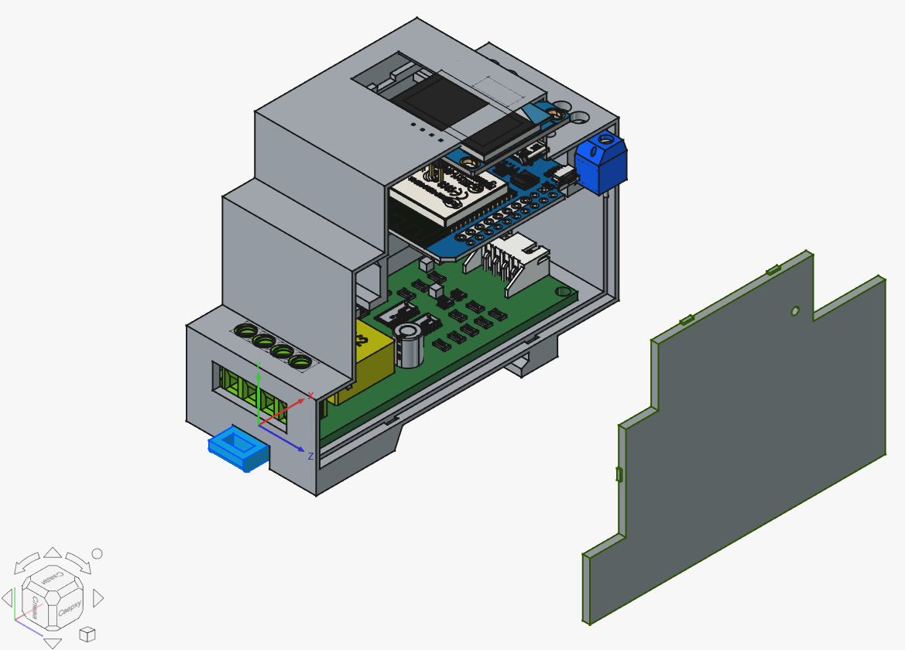

# Enclosure

English | [Русский](README.ru.md)

3D-printed enclosure for the eMeter32 energy meter. It holds the ESP32 board, the PZEM-004T module, the pulse input (comparator) board and the OLED display, and is designed to be printed on a regular FDM printer.

> [!WARNING]
> The enclosure contains parts connected to **230 V** mains. Keep the mains wiring insulated and physically separated from the low-voltage side, and close the enclosure before powering the device on.

## Files

The ready-to-print models are in [`stl/`](stl):

| File | Part | Qty |
|---|---|---|
| [`Pzem-004t_v4_2026-assembly-case.stl`](stl/Pzem-004t_v4_2026-assembly-case.stl) | Case (base) | 1 |
| [`Pzem-004t_v4_2026-assembly-cover.stl`](stl/Pzem-004t_v4_2026-assembly-cover.stl) | Cover | 1 |
| [`Pzem-004t_v4_2026-assembly-lock.stl`](stl/Pzem-004t_v4_2026-assembly-lock.stl) | Lock | 1 |

## What goes inside

| Part | Notes |
|---|---|
| ESP32 board (WEMOS D1 mini ESP32) | Main controller, the USB port should stay accessible |
| PZEM-004T module | Mains measurements, connected to the mains side |
| Pulse input board (LM393) | See the [comparator board](../comparator-board) |
| SSD1306 OLED, 128×64 | Status display |
| Push button | Opens the setup portal (hold for 3 s) |

## Print settings

<!-- TODO: fill in with the values you actually used -->

| Parameter | Value |
|---|---|
| Material | PLA / PETG (PETG is better for warm places) |
| Layer height | 0.2 mm |
| Perimeters | 3 |
| Infill | 20 % |
| Supports | TODO |
| Orientation | TODO |

## Assembly

1. Print the three parts from [`stl/`](stl).
2. Clean the parts and test-fit the boards before final assembly.
3. Mount the boards in the case and fix them. TODO: fasteners and sizes.
4. Connect the wires according to the [pinout](../../README.md#pinout).
5. Fit the cover and secure it with the lock. Check that nothing presses on the mains terminals.

If the display is mounted upside down, set `OLED_ROTATE_180` to `1` in [`oled.h`](../../components/oled/include/oled.h). The display module has a fixed yellow zone at the top, so after rotation it moves to the bottom.

## License

The models are released under the same [MIT License](../../LICENSE) as the project.
